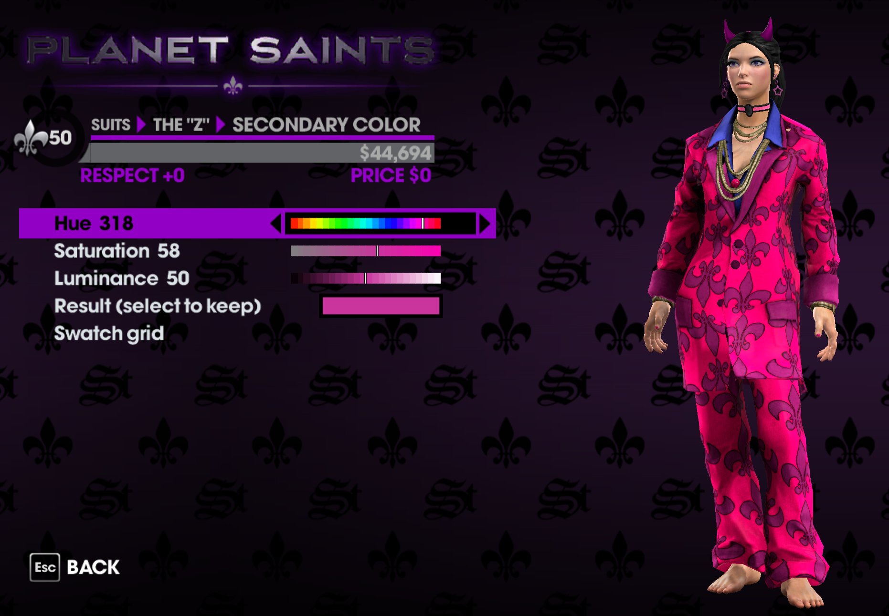

# Saints Row: The Third - Store Colour Picker



A true-RGB colour picker for the clothing stores in **Saints Row: The Third (PC, DX11)**. Instead of
the fixed swatch grid, every colour slot of a clothing item gets **Hue / Saturation / Luminance**
sliders with colour bars, a live preview on your character and the exact colour you picked.

The picker's UI is built with **[SR3 Mod UI](https://github.com/PurrsianMilkman/Saints-Row-The-Third-Mod-UI)**
(required): it hooks the stock clothing store at run time, so no store file is replaced.

Also included: an **F7 teleport** to the nearest clothing store (a testing helper), also on the picker's
**Pause > MODS** page.

> No game files are distributed here. `install.ps1` builds the modified game files from **your own**
> game install.

## What it does

| | |
|---|---|
| **Where** | Clothing stores: Planet Saints (all 5), Nobody Loves Me, Let's Pretend, Leather & Lace. Pick an item, then *Primary / Secondary / Tertiary colour*. |
| **Sliders** | Hue, Saturation, Luminance (SR3 Mod UI's HSL editor), each with a colour bar and a marker. |
| **Result** | Shows the colour; selecting it keeps the colour for that slot. **Back** restores the colour the slot had. |
| **Swatch grid** | Opens the game's original grid if you want a preset. |
| **Pause > MODS > Store Colour Picker** | Shows whether true RGB is on and how many custom slots are free; a button teleports you to a clothing store. |
| **F7 / Shift+F7** | Teleport to the nearest clothing store's entrance / cycle through all 8. |

### Why it needs a plugin for true RGB

The game never stores a colour for clothing: each colour slot stores an **index into a colour table**
(`character_color_pool.xtbl`), and the save keeps that index in **one byte**, so the table can hold at
most 255 colours. The mod fills the table up to 255 with extra entries; the plugin
(`SR3StoreColorPicker.asi`) then rewrites those entries in memory:

- two entries are **live slots**: while you drag a slider the exact colour is written there and previewed;
- the rest are **custom slots**: when you keep a colour it moves into one and is saved to
  `SR3StoreColors.ini` in the game folder; on every launch the plugin restores them before your save loads.

Limits that follow from the one-byte index:

- **Custom colours at once** = 255 minus the size of your colour table minus 2: **127** with the
  vanilla table, **58** if another colour mod already added 69 colours. Items in the same colour share
  a slot. When all are used, keeping a new colour falls back to the nearest existing one.
- Clothes in a custom colour depend on the plugin and the ini. Without the plugin those slots show
  their preset colours (the picker still works, snapping to the nearest of the 255 colours).
- In the swatch grid, don't pick the last two swatches: they are the live slots.

## Install

Requirements: the **DX11** executable (`SaintsRowTheThird_DX11.exe`), an **ASI loader**
(`dinput8.dll`, e.g. Ultimate ASI Loader), **[SR3 Mod UI](https://github.com/PurrsianMilkman/Saints-Row-The-Third-Mod-UI)**,
**Python 3** on PATH.

1. Close the game and install SR3 Mod UI.
2. Build the plugin with `build.bat` (Visual Studio 2022 Build Tools, x86). The v0.1.0 release plugin
   predates SR3 Mod UI support: with it the picker only snaps to preset colours.
3. Run:
   ```
   powershell -ExecutionPolicy Bypass -File install.ps1 -Game "C:\Games\Saints Row 3"
   ```

The installer stops if SR3 Mod UI is missing. It backs up an existing loose `character_color_pool.xtbl`
(from another colour mod) to `backup\` before replacing it, builds the files from your game's packfiles,
copies them and checks their hashes.

**Upgrading from v0.1:** v0.1 built its own picker into a rebuilt `store_clothing.str2_pc` (plus the
`patch_vint_doc_containers.asm_pc` holding its size record). Those files would replace the SR3 Mod UI
picker, so the installer removes both, but only if the `.str2_pc` is the v0.1 one. Your kept colours
(`SR3StoreColors.ini`) carry over.

**Uninstall:** `install.ps1 -Uninstall` (restores the colour table; keeps `SR3StoreColors.ini`).

Your support is greatly appreciated. Nothing is paywalled: https://www.patreon.com/cw/Purrsian

### Files it puts in the game folder

| File | What |
|---|---|
| `SR3ModUI\mods\store_color_picker.lua` | the picker (an SR3 Mod UI script) |
| `character_color_pool.xtbl` | your colour table, unchanged, plus `hsl_NN` entries up to 255 |
| `sr3_city.lua` | the city script plus a thread that polls the F7 hotkey |
| `SR3StoreColorPicker.asi` | the plugin (true RGB + teleport); writes `SR3StoreColorPicker.log` |
| `SR3StoreColors.ini` | created when you keep your first custom colour |

## Status

| | |
|---|---|
| Picker with SR3 Mod UI: sliders, colour bars, live preview, keep | confirmed in game (keyboard; mouse and controller untested) |
| Pause > MODS page and its teleport button | confirmed in game |
| Exact colour written to the live slots while dragging | confirmed in game (plugin log) |
| Kept colours saved and restored before the save loads | confirmed in game |
| F7 teleport lands at the store entrance | confirmed in game (all 8 points are floor-level entrance navpoints; Planet Saints tested) |
| DX9 executable | not supported (the plugin checks the DX11 bytes and does nothing on anything else) |
| Co-op | untested |

## How it works (for modders)

- `src/modui/store_color_picker.lua` wraps the stock `store_clothing_item_details` with `ModUI.wrap`;
  the item menu's colour rows then open a `ModUI.HslEditor` instead of the grid. The plugin answers the
  script through `ModUI.call("storecolors", cmd, r, g, b)` and adds the teleport button to the page with
  the C API (`src/asi/sr3modui.h`, a copy of SR3 Mod UI's header). The plugin also wraps
  `teleport_to_object` in the gameplay state for F7, by swapping the function pointer in the Lua
  registration table.
- Colour model: the cloth shader shows a table value `v` as `Reinhard(5 * v/255)`; sliders are sRGB,
  converted to linear, scaled into that range and inverted through the curve.
- `tools/build_str2.py` reads and rebuilds compressed+condensed `.str2_pc` files (one zlib level-9
  stream, a sync flush after each file, no final block); the installer uses it to recognise the v0.1
  store file.
- Syntax check: `python tools/luacheck.py check src/modui/store_color_picker.lua` (`luacheck.py` loads a
  Lua 5.1 DLL; set its path at the top). SR3 Mod UI's own offline simulation is in its repo
  (`test/sim.lua`).

## License

MIT. Saints Row: The Third is © Deep Silver / Volition; this repository contains none of its files.
